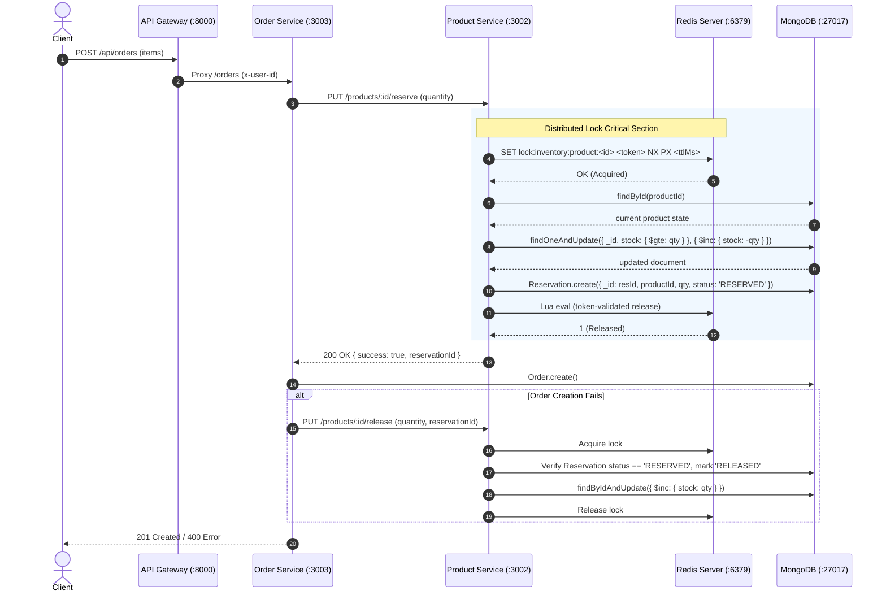

# Redis Distributed Locking for Product Stock Reservation

## 1. Overview & Objective

In high-concurrency environments, multiple client requests may simultaneously attempt to order the same limited-inventory product. Without distributed mutual exclusion across instances, concurrent requests handled by separate Order Service instances or Product Service instances can cause race conditions, write conflicts, or overselling.

This document details the implementation of **Redis-based Distributed Locking** combined with authoritative **MongoDB conditional updates** and **idempotent stock compensation**.

---

## 2. Architecture & Sequence



---

## 3. Distributed Lock Implementation Details

### Lock Key Format
Locks are scoped strictly per product resource:
```
lock:inventory:product:<productId>
```

### Safe Lock Acquisition
* Command: `SET lock-key unique-token NX PX ttl-ms`
* `NX`: Guarantees mutual exclusion—only one contender can acquire the key.
* `PX`: Grants a bounded lease duration (default: `5000ms`).
* `unique-token`: A cryptographically random UUID (`uuidv4()`) generated per acquisition attempt to guarantee ownership.
* **Bounded Retries with Jitter:** Contenders retry with randomized backoff (default: `50ms` + `0-20ms` jitter) until acquired or until `timeoutMs` (default: `3000ms`) is exceeded.
* If contention times out, raises `LockAcquisitionTimeoutError` (HTTP 409).

### Safe Lock Release
A lock is released **only** if the token currently in Redis matches the caller's unique ownership token. This is executed atomically via Lua:

```lua
if redis.call("get", KEYS[1]) == ARGV[1] then
    return redis.call("del", KEYS[1])
else
    return 0
end
```
* **Prevents Stale Deletion:** If Contender A's lease expires due to an unforeseen latency spike and Contender B acquires the lock, Contender A's subsequent release will return `0` and **never delete Contender B's active lock**.

### Safe Lock Extension (Lease Renewal)
If an operation requires additional time before completion, the lease is safely extended only by the token owner:

```lua
if redis.call("get", KEYS[1]) == ARGV[1] then
    return redis.call("pexpire", KEYS[1], tonumber(ARGV[2]))
else
    return 0
end
```

### Redis Failure Policy
* If the Redis server is offline or fails command execution, the lock acquisition throws `RedisUnavailableError` with HTTP status **503 Service Unavailable**.
* The system **never silently bypasses** distributed locking when Redis fails.

---

## 4. Multi-Layer Correctness Safeguards

Even with distributed locking, a robust distributed system cannot rely solely on in-memory locks:

1. **Short Critical Section:** The lock is held **only** during the in-service database read, conditional update, and reservation write. Unrelated network calls (e.g. gateway hops, order persistence) occur outside the lock.
2. **Authoritative Conditional MongoDB Decrement:**
   ```ts
   Product.findOneAndUpdate(
     { _id: productId, stock: { $gte: quantity } },
     { $inc: { stock: -quantity } },
     { new: true }
   );
   ```
   Even in catastrophic scenarios where a lock lease expires, MongoDB's atomic `{ stock: { $gte: quantity } }` condition guarantees stock **never drops below 0**.
3. **Idempotent Compensation (`Reservation` Collection):**
   * Each reservation creates a record with status `RESERVED`.
   * On order creation failure, `order-service` calls `PUT /products/:id/release` with `reservationId`.
   * `product-service` checks that `Reservation.status === 'RESERVED'` before incrementing stock and marks it `RELEASED`.
   * Duplicate / replayed release requests see `alreadyCompensated: true` and **do not increment stock again**.

---

## 5. Configuration & Environment Variables

Add to `.env`:

| Variable | Default | Description |
| :--- | :--- | :--- |
| `REDIS_URL` | `redis://127.0.0.1:6379` | Connection string for Redis instance |
| `REDIS_LOCK_TTL_MS` | `5000` | Lease duration in milliseconds |
| `REDIS_LOCK_TIMEOUT_MS` | `3000` | Max wait time before timing out contention |
| `REDIS_LOCK_RETRY_DELAY_MS` | `50` | Base retry interval between lock acquisition attempts |

---

## 6. Local Setup & Testing (Without Docker)

### 1. Start Local Redis Server
```bash
# Verify installation
which redis-server

# Check status / start local service
redis-cli ping # Expected: PONG
```

### 2. Run Tests

#### Unit Tests (Lock semantics, expiration, stale releases, timeouts, connection failure)
```bash
npm run test:lock-unit
```

#### Inventory Integration Tests (Real Redis + MongoDB across multi-process Order & Product services)
```bash
npm run test:lock-integration
```

#### Run All Lock Tests
```bash
npm run test:lock
```

---

## 7. Known Limitations & Trade-offs

1. **Process Crashes Before Compensation:** If `order-service` crashes mid-order after reserving stock but before writing compensation, the reservation remains until an inventory reconciliation worker / TTL sweeper processes expired reservations.
2. **Single-Node Redis vs Redis Cluster/Redlock:** This implementation uses standard single-instance Redis distributed locking. For multi-datacenter or multi-master Redis deployments, the Redlock algorithm or Redis Cluster consensus should be evaluated.

