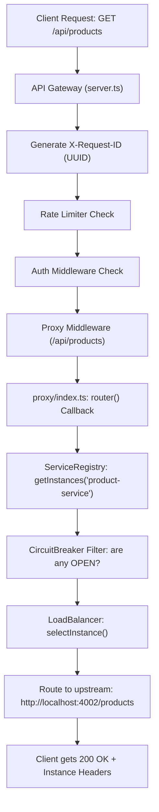

Here is a step-by-step **dry run** walking through the entire lifecycle—from how a service registers itself to how an incoming request gets load-balanced and routed.

---

### Step 1: Microservice Boots & Self-Registers

Let's say you start a new instance of **Product Service** on port `4002`.

1. **Service Starts:** [`product-service/src/server.ts`](file:///home/bumblebee/apigateway/product-service/src/server.ts) starts listening on port `4002`.
2. **Auto-Registration Trigger:** In [`registerService.ts`](file:///home/bumblebee/apigateway/product-service/src/registry/registerService.ts#L23), it immediately fires an HTTP call to the Gateway:
   ```http
   POST http://localhost:8000/registry/register
   {
     "serviceName": "product-service",
     "port": 4002,
     "host": "localhost",
     "id": "product-dynamic-4002",
     "url": "http://localhost:4002"
   }
   ```
3. **Gateway Stores It:** The Gateway's [`ServiceRegistry`](file:///home/bumblebee/apigateway/api-gateway/src/loadbalance/ServiceRegistry.ts#L49-L88) receives this and adds it to its internal memory map:

```
ServiceRegistry Map:
"product-service" ──▶ [
  { id: "product-dynamic-4001", url: "http://localhost:4001", healthy: true },
  { id: "product-dynamic-4002", url: "http://localhost:4002", healthy: true }  <-- Added!
]
```

4. **Heartbeat Loop:** Every 10 seconds, `product-service` pings `POST /registry/heartbeat`. If it misses heartbeats for 30 seconds, the Gateway marks `healthy: false`.

---

### Step 2: Client Sends a Request to API Gateway

A user opens their browser or app and requests:
```http
GET http://localhost:8000/api/products
```

Here is what happens inside the Gateway pipeline:



---

### Step 3: Inside `proxy/index.ts` — The Load Balancer in Action

When Express hits the proxy route in [`api-gateway/src/proxy/index.ts`](file:///home/bumblebee/apigateway/api-gateway/src/proxy/index.ts#L15-L41):

#### 1. Querying Healthy Instances
```ts
const instances = serviceRegistry.getInstances('product-service');
```
* The registry checks health status (`healthy === true`) **AND** checks the Circuit Breaker (`circuitBreaker.canRequest() === true`).
* Returns the usable pool:
  ```ts
  [
    { id: "product-dynamic-4001", url: "http://localhost:4001" },
    { id: "product-dynamic-4002", url: "http://localhost:4002" }
  ]
  ```

#### 2. The Load Balancer Decision
The Gateway calls the selected algorithm (e.g. `ROUND_ROBIN` in [`RoundRobinStrategy.ts`](file:///home/bumblebee/apigateway/api-gateway/src/loadbalance/RoundRobinStrategy.ts)):

```ts
const selectedInstance = lbStrategy.selectInstance('product-service', instances, context);
```

**Under the hood (Round Robin dry run):**
* The strategy keeps an internal counter per service:
  ```ts
  counter = this.counters.get('product-service') // currently 0
  index = counter % instances.length             // 0 % 2 = 0 -> chooses 4001
  this.counters.set('product-service', counter + 1)
  ```
* **Request 1:** `index = 0` $\rightarrow$ routes to `http://localhost:4001`
* **Request 2:** `index = 1` $\rightarrow$ routes to `http://localhost:4002`
* **Request 3:** `index = 2 % 2 = 0` $\rightarrow$ wraps back to `http://localhost:4001`

#### 3. Rewriting & Forwarding
The router function returns:
```ts
return selectedInstance.url; // "http://localhost:4002"
```
`http-proxy-middleware` forwards the request directly to:
```
http://localhost:4002/products
```

---

### Step 4: Upstream Response & Tracking

When `product-service` on port `4002` finishes processing:

1. **Proxy attaches observability headers** in [`proxyRes`](file:///home/bumblebee/apigateway/api-gateway/src/proxy/index.ts#L51-L68):
   * `x-upstream-instance: product-dynamic-4002`
   * `x-upstream-url: http://localhost:4002`
   * `x-lb-strategy: ROUND_ROBIN`
2. **Circuit Breaker updates:**
   * If status is `200`, records `circuitBreaker.onSuccess()`.
   * If status is `500+`, records `circuitBreaker.onFailure()`.
3. **Least Connections counter:**
   * If using `LEAST_CONNECTIONS`, decrements `activeConnections` on port `4002`.
4. **Client receives response:**
   ```json
   {
     "products": [ ... ]
   }
   ```

---

### What happens if an instance crashes? (The Safety Net)

If `4002` crashes or starts failing:
1. **Circuit Breaker trips to `OPEN`** after 3 failures.
2. Next time `serviceRegistry.getInstances('product-service')` runs:
   * It sees `4002` is `OPEN` and **excludes it** from the array.
3. The Load Balancer now only receives `[ 4001 ]`.
4. Traffic is **100% routed to 4001**, preventing any clients from seeing errors.