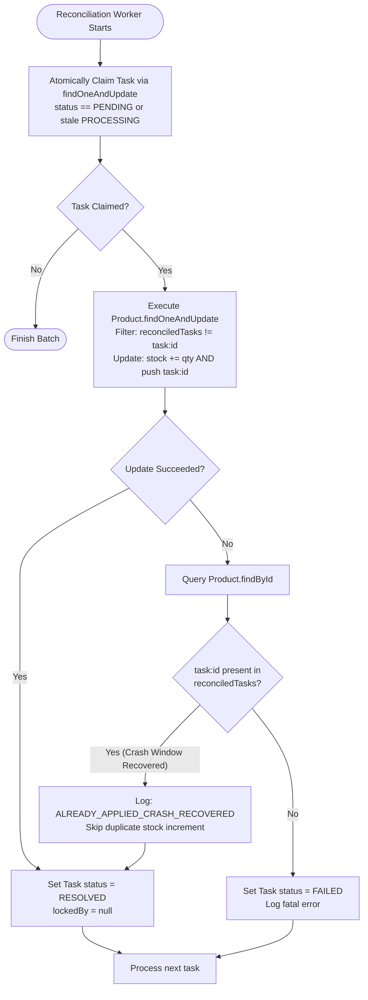

# Redis Distributed Lock, Crash Consistency & Inventory Reconciliation

This document explains the architecture, failure recovery design, and operational guarantees for **Distributed Locking with Redis** and **Crash-Consistent Inventory Reconciliation** in this microservices architecture.

---

## 1. Executive Summary & Why This Is Needed

### The Business Challenge: High-Concurrency Flash Sales
In high-concurrency e-commerce systems, inventory allocation is vulnerable to **overselling (race conditions)**, **lost updates**, and **deadlocks**.
- Redis distributed locks ensure that only **one thread/process** manipulates inventory for a given product at any single point in time.
- However, distributed locking alone does not guarantee database consistency when a node **crashes midway through execution**, network partitions occur, or downstream services timeout.

### The Storage Challenge: Standalone MongoDB Limitations
In production configurations where MongoDB runs as a single standalone node (or without multi-document distributed replica set transactions):
- Multi-document transactions (`session.withTransaction(...)`) are **not available**.
- Operations that mutate state across multiple collections (e.g., updating `products` inventory while creating or updating `reconciliation_tasks` / `reservations`) cannot be committed in a single distributed ACID transaction.

### The Crash Window Hazard (Dual-Write Failure)
Without multi-document transactions, recovering lost or abandoned inventory creates a classic distributed systems hazard:

```
[ Worker / Service Process ]
             │
             ▼
Step 1: Increment stock in 'products' collection   ───► [ Succeeded in DB ]
             │
      💥 NODE CRASHES / NETWORK TIMEOUT 💥
             │
Step 2: Mark task RESOLVED in 'reconciliation_tasks' ──► [ NEVER EXECUTED ]
```

If another recovery worker subsequently wakes up, discovers the task still sitting in `PENDING` or abandoned `PROCESSING` state, and blindly retries it:
- The stock would be incremented **twice**, causing **phantom inventory leaks**.
- If two recovery workers run concurrently without coordination, both could attempt to apply the same compensation task simultaneously.

To resolve these hazards deterministically without requiring multi-collection distributed transactions, the system implements a **Token-Guaranteed Crash-Consistent Reconciliation Pattern**.

---

## 2. What Is Implemented: Architecture & Components

The crash consistency and inventory safety layer spans across Redis locking, Mongoose models, and a dedicated background reconciliation engine:

```
                                      ┌────────────────────────────────────────┐
                                      │         API Gateway / Client           │
                                      └──────────────────┬─────────────────────┘
                                                         │
                                                         ▼
                                       product-service (Port 3002)
                     ┌───────────────────────────────────┴───────────────────────────────────┐
                     │                                                                       │
           [ Active Request Flow ]                                              [ Recovery Worker Flow ]
                     │                                                                       │
                     ▼                                                                       ▼
   ┌───────────────────────────────────┐                                   ┌───────────────────────────────────┐
   │       Redis Distributed Lock      │                                   │       Reconciliation Engine       │
   │  acquireLock('product:{id}', ttl) │                                   │  reconcilePendingTasks(options)   │
   └─────────────────┬─────────────────┘                                   └─────────────────┬─────────────────┘
                     │                                                                       │
                     ▼                                                                       ▼
   ┌───────────────────────────────────┐                                   ┌───────────────────────────────────┐
   │        Atomic Inventory Mutex     │                                   │     Atomic Task Claim & Lock      │
   │   stock >= qty decrement (Mongo)  │                                   │     Stale Task Stealing (30s)     │
   └─────────────────┬─────────────────┘                                   └─────────────────┬─────────────────┘
                     │                                                                       │
         (On partial failure)                                                                ▼
                     ▼                                                     ┌───────────────────────────────────┐
   ┌───────────────────────────────────┐                                   │ Single-Doc Idempotent Compensation│
   │  ReconciliationTask (PENDING)     │ ─────────────────────────────────►│ { $inc: stock,                    │
   │  action: 'RESTORE_STOCK'          │                                   │   $addToSet: reconciledTasks }    │
   └───────────────────────────────────┘                                   └─────────────────┬─────────────────┘
                                                                                             │
                                                                           ┌─────────────────┴─────────────────┐
                                                                           │                                   │
                                                                  [ Fresh Application ]              [ Crash Detected ]
                                                                           │                                   │
                                                                    Stock incremented                 Task token already in
                                                                    Token recorded                    array; skip $inc
                                                                           │                                   │
                                                                           └─────────────────┬─────────────────┘
                                                                                             ▼
                                                                                   Mark task: RESOLVED
```

### Core Components & Schemas

#### 1. `Product` Model (`product-service/src/models/Product.ts`)
Tracks stock and an atomic journal of reconciled task tokens:
```typescript
{
  _id: ObjectId,
  name: String,
  stock: Number,
  price: Number,
  reservedStock: Number,
  reconciledTasks: {
    type: [String],
    default: []
  }
}
```
- **`reconciledTasks`**: Array of string identifiers (`task:<taskId>`) representing tasks that have updated this product's stock.

#### 2. `ReconciliationTask` Model (`product-service/src/models/ReconciliationTask.ts`)
Tracks asynchronous compensation operations:
```typescript
{
  _id: ObjectId,
  productId: String,
  reservationId: String,
  quantity: Number,
  action: 'RESTORE_STOCK' | 'RELEASE_STOCK',
  status: 'PENDING' | 'PROCESSING' | 'RESOLVED' | 'FAILED',
  attempts: Number,
  lockedAt?: Date,
  lockedBy?: string,
  resolvedAt?: Date,
  error?: string
}
```

#### 3. `reconciliationService` (`product-service/src/services/reconciliationService.ts`)
Contains the core worker loop `reconcilePendingTasks()` that executes claim-check-compensate routines.

#### 4. REST Trigger Endpoint (`productController.ts`)
Exposes reconciliation to scheduled cron jobs or manual trigger:
- `POST /products/reconcile` (Accepts optional `staleTimeoutMs`, `workerId`, `maxTasks`)

---

## 3. How It Works: The Three Guarantees

The reconciliation mechanism achieves exact-once compensation through three interlocking guarantees:

### Guarantee 1: Mutual Exclusion via Atomic Task Claiming
To prevent multiple reconciliation workers from racing on the same task:
```typescript
const staleCutoff = new Date(Date.now() - staleTimeoutMs);

const task = await ReconciliationTask.findOneAndUpdate(
  {
    $or: [
      { status: 'PENDING' },
      { status: 'PROCESSING', lockedAt: { $lt: staleCutoff } }
    ]
  },
  {
    $set: {
      status: 'PROCESSING',
      lockedAt: new Date(),
      lockedBy: workerId
    },
    $inc: { attempts: 1 }
  },
  { new: true }
);
```
- **Concurrency Protection:** MongoDB's document-level write lock ensures that only **one worker** can match and update a given task document. Other concurrent workers receive `null` or the next task.
- **Dead Worker Recovery (Stale Task Stealing):** If a worker claims a task and immediately dies (or experiences an unhandled freeze), `lockedAt` preserves the claim time. Once `staleTimeoutMs` (e.g. 30 seconds) elapses, any healthy worker can safely steal the task and resume execution.

---

### Guarantee 2: Idempotent Single-Document Stock Increment
In standalone MongoDB, multi-collection transactions are not guaranteed, but **all updates on a single document are strictly atomic and serialized**.

The system merges the stock increment and the audit token into a **single atomic query**:
```typescript
const taskToken = `task:${task._id}`;

const productUpdate = await Product.findOneAndUpdate(
  {
    _id: task.productId,
    reconciledTasks: { $ne: taskToken } // PRECONDITION: Token must not exist
  },
  {
    $inc: { stock: task.quantity },     // 1. Increment inventory
    $addToSet: { reconciledTasks: taskToken } // 2. Record token atomically
  },
  { new: true }
);
```

#### What this achieves:
1. **Zero Intermediate State:** It is impossible for `stock` to be incremented without `reconciledTasks` recording the `taskToken`. Both fields commit or abort together in the single document write.
2. **Precondition Guard:** If `taskToken` is already present in `reconciledTasks`, the query selector `{ reconciledTasks: { $ne: taskToken } }` evaluates to `false`. MongoDB rejects the update and returns `null`.

---

### Guarantee 3: Post-Increment Crash Recovery (`alreadyApplied` Detection)
Consider the exact crash scenario:
1. Worker A claims the task.
2. Worker A executes the single-document atomic update on `Product`. (Stock is restored, `taskToken` is recorded).
3. **Worker A's container is killed (`kill -9`) before it can call `task.status = 'RESOLVED'`**.
4. The task remains in MongoDB with `status: 'PROCESSING'` and Worker A's old `lockedAt` timestamp.

#### The Recovery Sequence:
1. After 30 seconds, Worker B runs and claims the stale task via `lockedAt: { $lt: staleCutoff }`.
2. Worker B attempts the atomic stock update:
   ```typescript
   Product.findOneAndUpdate(
     { _id: task.productId, reconciledTasks: { $ne: taskToken } },
     ...
   )
   ```
3. Because Worker A already committed `taskToken`, the query condition `{ $ne: taskToken }` fails. `productUpdate` returns `null`.
4. Worker B inspects the product:
   ```typescript
   const existingProduct = await Product.findById(task.productId);
   if (existingProduct.reconciledTasks.includes(taskToken)) {
     // CRASH RECOVERY DETECTED:
     alreadyApplied = true;
     // Stock was ALREADY restored prior to the crash.
     // DO NOT increment stock again!
   }
   ```
5. Worker B transitions `task.status = 'RESOLVED'` and finishes.
6. **Result:** Zero inventory duplication, 100% data consistency.

---

## 4. Crash Recovery Lifecycle Flowchart



---

## 5. Redis Distributed Lock Integration

In normal operation, stock reservation and order processing use **Redis Distributed Locks** to eliminate database contention:

```typescript
// acquire lock
const lockKey = `product:${productId}`;
const lockAcquired = await redisLock.acquire(lockKey, 5000); // 5s TTL

if (!lockAcquired) {
  return res.status(409).json({ error: 'Concurrent reservation in progress, please retry' });
}

try {
  // Read and mutate stock atomically
  const product = await Product.findById(productId);
  if (product.stock >= requestedQty) {
    product.stock -= requestedQty;
    await product.save();
  }
} finally {
  // Release lock safely with Lua script to verify lock ownership
  await redisLock.release(lockKey);
}
```

### Defense-in-Depth Layering:
1. **Redis Lock (Fast Path):** Provides millisecond-level serialization at the application gateway/service boundary to eliminate race conditions before hitting the database.
2. **Atomic MongoDB Decrement (Middle Path):** Guards against race conditions if Redis is temporarily bypassed or fails over.
3. **Reconciliation Engine (Recovery Path):** Guarantees eventual consistency and restores orphaned stock if containers crash, network partitions sever connections, or downstream microservices fail.

---

## 6. Deterministic Test Verification

This implementation is verified by automated integration tests in [`test/redis-lock-integration.js`](file:///home/bumblebee/apigateway/test/redis-lock-integration.js):

| Test Suite | Scenario Tested | Outcome Verified |
| :--- | :--- | :--- |
| **Test 8f** | **Recoverable Reconciliation Mechanism** | Verifies orphaned reservation creates `PENDING` task, and running reconciliation restores stock to exact baseline. |
| **Test 8g** | **Concurrent Duplicate Workers** | Spawns multiple parallel workers attempting to process the identical task. Exactly one succeeds; zero duplicate stock increments. |
| **Test 8h** | **Crash Window Simulation** | Artificially injects the post-increment crash window (applies stock increment and token, leaves task `PROCESSING`). Next worker detects `alreadyApplied`, skips stock increment, and marks task `RESOLVED`. |

All tests pass deterministically under Node.js runtime without Docker or external dependencies.

