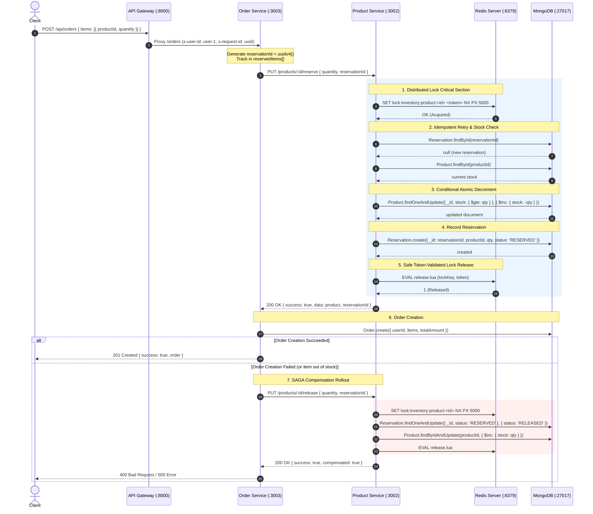

# Redis Distributed Locking for Product Stock Reservation

## 1. Overview & Objective

In high-concurrency e-commerce environments, multiple users often attempt to purchase the same inventory item at the exact same millisecond (e.g. flash sales, limited-edition book releases).

When microservices scale horizontally:
* Multiple instances of **Order Service** handle incoming checkout requests in parallel.
* Multiple instances of **Product Service** process inventory operations simultaneously.
* In-memory language-level mutexes (such as Node.js local locks) **cannot protect shared state** across multiple processes or containers.

This system combines **Redis-based Distributed Mutual Exclusion** (`SET NX PX` + atomic Lua scripts) with **Authoritative MongoDB Single-Document Atomic Decrements** (`{ stock: { $gte: qty } }`), **Idempotent Reservation Records**, and a **Crash-Consistent Reconciliation Worker** to guarantee that inventory can **never be oversold**, even during process crashes or network partitions.

---

## 2. Complete End-to-End Sequence Diagram



---

## 3. Detailed File-by-File Breakdown

### 1. `product-service/src/lock/RedisClient.ts`
* **Purpose:** Establishes and manages the lifecycle of a shared, reusable, singleton Redis client connection using `ioredis`. Avoids opening expensive TCP/TLS sockets per HTTP request.
* **Key Functions & Exports:**
  * `getRedisClient(): Redis`: Lazily initializes and returns the shared `Redis` singleton. Configures bounded reconnect backoff (`maxRetriesPerRequest: 1`, `connectTimeout: 5000ms`, `retryStrategy`).
  * `isRedisConnected(): boolean`: Returns whether Redis is connected and in a `'ready'` state.
  * `closeRedisClient(): Promise<void>`: Gracefully quits the Redis connection during process shutdown.
* **How It Interacts:** Imported by `RedisDistributedLock.ts` as the underlying execution transport for Redis commands and Lua scripts.

---

### 2. `product-service/src/lock/RedisDistributedLock.ts`
* **Purpose:** The core distributed locking engine implementing mutual exclusion, bounded retry backoff with jitter, token validation, lease extension, and failure policy.
* **Key Classes & Interfaces:**
  * `RedisUnavailableError` (HTTP 503): Thrown whenever Redis is unreachable or offline. Guarantees the system **never silently bypasses locking**.
  * `LockAcquisitionTimeoutError` (HTTP 409): Thrown when lock contention exceeds the configured `timeoutMs`.
  * `LockHandle`: Returned upon successful acquisition, providing `{ token, leaseExpiresAt, extend(), release() }`.
  * `RedisDistributedLock`:
    * `acquireLock(resourceKey, options)`: Executes `SET lock:key token NX PX ttlMs`. If already held, retries with bounded exponential backoff and randomized jitter (10–20ms).
    * `releaseLock(resourceKey, lockToken)`: Evaluates an atomic Lua script:
      ```lua
      if redis.call("get", KEYS[1]) == ARGV[1] then
          return redis.call("del", KEYS[1])
      else
          return 0
      end
      ```
      Guarantees that a slow owner whose lease expired **cannot delete a newer owner's active lock**.
    * `extendLock(resourceKey, lockToken, ttlMs)`: Atomically renews the lease via Lua script (`pexpire`) if the token matches.
    * `withLock(resourceKey, fn, options)`: Higher-order function executing an async block inside a critical section, guaranteeing release in a `finally` block.
* **How It Interacts:** Instantiated as the singleton `distributedLock` and imported by `productController.ts` to wrap inventory reservation and release operations.

---

### 3. `product-service/src/models/Reservation.ts`
* **Purpose:** Defines the Mongoose schema and model for tracking product stock reservation lifecycles.
* **Key Properties:**
  * `_id: string`: Unique reservation ID (client/Order Service provided UUID).
  * `productId: string`: ID of the reserved product.
  * `quantity: number`: Number of units reserved.
  * `status: 'RESERVED' | 'RELEASED' | 'CONFIRMED'`: Current lifecycle state.
* **How It Interacts:** Queried by `productController.ts` on retries (idempotency check) and updated during SAGA compensation in `releaseStock`.

---

### 4. `product-service/src/models/ReconciliationTask.ts`
* **Purpose:** Persistent task queue in MongoDB for unresolved stock discrepancy tasks, specifically designed for standalone MongoDB deployments where multi-document transactions are unavailable.
* **Key Properties:**
  * `productId: string`: Target product requiring stock correction.
  * `reservationId: string`: Associated reservation UUID.
  * `quantity: number`: Quantity of stock to restore.
  * `action: 'RESTORE_STOCK'`: Reconciliation action type.
  * `status: 'PENDING' | 'PROCESSING' | 'RESOLVED' | 'FAILED'`: Lifecycle state.
  * `lockedAt?: Date`: Timestamp when a worker claimed the task (for lease expiration / crash detection).
  * `lockedBy?: string`: Unique ID of the worker currently processing the task.
  * `attempts?: number`: Number of processing attempts.
* **How It Interacts:** Created by `productController.ts` if a rollback fails; claimed and resolved by `reconciliationService.ts`.

---

### 5. `product-service/src/models/Product.ts`
* **Purpose:** Authoritative MongoDB product catalog and inventory model.
* **Key Enhancements:**
  * Added `reconciledTasks: { type: [String], default: [] }`: Stores array of reconciled task tokens (`task:<taskId>`).
  * Enables **single-document atomic updates** that couple stock restoration (`$inc: { stock: quantity }`) with token registration (`$addToSet: { reconciledTasks: taskToken }`), preventing duplicate stock restoration during post-increment crashes.

---

### 6. `product-service/src/services/reconciliationService.ts`
* **Purpose:** Autonomous, crash-consistent background sweeper that reconciles dangling stock discrepancy tasks in standalone MongoDB.
* **Key Functions:**
  * `reconcilePendingTasks(options?: ReconcileOptions): Promise<ReconciliationReport>`:
    1. **Atomic Mutual Exclusion:** Uses `findOneAndUpdate` to claim tasks transitioning from `'PENDING'` (or expired `'PROCESSING'`) to `'PROCESSING'`, stamping `lockedBy: workerId`. Multiple workers will **never process the same task simultaneously**.
    2. **Conditional Atomic Increment:** Updates product with:
       ```typescript
       Product.findOneAndUpdate(
         { _id: task.productId, reconciledTasks: { $ne: taskToken } },
         { $inc: { stock: task.quantity }, $addToSet: { reconciledTasks: taskToken } }
       )
       ```
    3. **Crash Recovery (`alreadyApplied` Detection):** If a worker previously incremented stock and crashed before marking the task `RESOLVED`, the next worker detects that `reconciledTasks` already contains `taskToken`, **skips double-incrementing stock**, and marks the task `RESOLVED`.
* **How It Interacts:** Invoked via `productController.runReconciliation` or scheduled background cron jobs.

---

### 7. `product-service/src/controllers/productController.ts`
* **Purpose:** HTTP controller implementing inventory reservation, compensation release, and manual/automated reconciliation triggers.
* **Key Endpoints:**
  * `reserveStock(req, res)` (`PUT /products/:id/reserve`):
    1. Acquires product-scoped Redis lock (`lock:inventory:product:<id>`).
    2. Validates existing reservation for idempotent retry: verifies matching `productId` and `quantity`. Rejects mismatched reuse with **HTTP 409 Conflict**.
    3. Verifies stock availability.
    4. Executes authoritative atomic decrement:
       `Product.findOneAndUpdate({ _id, stock: { $gte: quantity } }, { $inc: { stock: -quantity } })`.
    5. Records `Reservation.create(...)`.
    6. If recording reservation fails, catches error, immediately rolls back stock decrement. If rollback fails, logs `FATAL` structured JSON and creates a `ReconciliationTask`.
    7. Releases Redis lock in `finally`.
  * `releaseStock(req, res)` (`PUT /products/:id/release`):
    1. Acquires product-scoped Redis lock.
    2. Validates that reservation belongs to requested `productId` and `quantity`.
    3. Atomically updates status from `'RESERVED'` $\to$ `'RELEASED'`. Duplicate compensation attempts safely no-op (`alreadyCompensated: true`).
    4. Restores stock via `$inc: { stock: quantity }`. If restoration fails, reverts status to `'RESERVED'` for retry and returns `{ compensated: false }`.
    5. Releases Redis lock in `finally`.
  * `runReconciliation(req, res)` (`POST /products/reconcile`):
    Invokes `reconcilePendingTasks()` and returns a detailed execution report.

---

### 8. `product-service/src/routes/productRoutes.ts`
* **Purpose:** Registers HTTP routes for Product Service endpoints.
* **Key Routes:**
  * `PUT /:id/reserve` $\to$ `productController.reserveStock`
  * `PUT /:id/release` $\to$ `productController.releaseStock`
  * `POST /reconcile` $\to$ `productController.runReconciliation`

---

### 9. `order-service/src/controllers/orderController.ts`
* **Purpose:** Orchestrates multi-item order placement, client-side reservation tracking, and SAGA compensation.
* **Key Functions:**
  * `createOrder(req, res)`:
    1. Pre-generates `reservationId = randomUUID()` upfront for each item and tracks it in `reservedItems[]`.
    2. Calls `PUT /products/:id/reserve` for each item.
    3. Creates and persists the `Order` in MongoDB.
    4. If any step fails (out of stock, network drop, database error), catches exception, iterates through `reservedItems[]`, and calls `PUT /products/:id/release` to restore inventory.

---

### 10. `test/redis-lock-unit.js`
* **Purpose:** Deterministic unit test suite testing Redis locking semantics directly against Redis:
  * Lock acquisition & mutual exclusion.
  * Token-validated release (invalid tokens rejected).
  * Lease expiration and re-acquisition.
  * Stale owner cannot delete newer owner's lock.
  * Bounded contention timeout with backoff.
  * Unreachable Redis raises `RedisUnavailableError` (HTTP 503).

---

### 11. `test/redis-lock-integration.js`
* **Purpose:** End-to-end multi-process integration test suite spawning real Product and Order service processes:
  * **Test 1–4:** Two separate Order Service processes concurrently buying the last stock (`stock=1`). Exactly 1 succeeds, 1 fails; final stock is 0.
  * **Test 5:** Insufficient stock fails without modifying inventory.
  * **Test 6:** Independent concurrent requests for different products execute in parallel.
  * **Test 7:** Multi-item order failure triggers stock compensation.
  * **Test 8:** Duplicate compensation is idempotent (no double increments).
  * **Test 8b:** Concurrent compensation race handled atomically.
  * **Test 8c:** Client timeout retry is idempotent.
  * **Test 8d:** Reusing `reservationId` with mismatched parameters returns HTTP 409.
  * **Test 8e:** Releasing with mismatched parameters returns HTTP 400.
  * **Test 8f:** Standalone MongoDB reconciliation worker resolves pending tasks.
  * **Test 8g:** Multiple concurrent reconciliation workers coordinate without duplicate increments.
  * **Test 8h:** Post-increment crash window simulation: worker detects `alreadyApplied: true` and avoids duplicate increments.
  * **Test 9:** Redis unavailable returns controlled HTTP 503.
  * **Test 10:** Conditional MongoDB decrement prevents overselling even if lock expires.

---

## 4. How the Components Work Together

```
[Client]
   │
   ▼ POST /api/orders
[API Gateway] (:8000)
   │ (Round-Robin Load Balancer)
   ▼ POST /orders
[Order Service] (:3003)
   │
   │ 1. Pre-generate reservationId
   │ 2. PUT /products/:id/reserve { reservationId }
   ▼
[Product Service] (:3002)
   │
   ├──▶ [Redis] (:6379)
   │       SET lock:inventory:product:<id> <token> NX PX 5000
   │       (Acquires distributed lock)
   │
   ├──▶ [MongoDB: Reservation]
   │       Check existing reservation (Idempotency)
   │
   ├──▶ [MongoDB: Product]
   │       findOneAndUpdate({ _id, stock: >= qty }, { $inc: -qty })
   │       (Authoritative atomic decrement)
   │
   ├──▶ [MongoDB: Reservation]
   │       create({ _id: reservationId, status: 'RESERVED' })
   │
   └──▶ [Redis]
           EVAL release.lua (Atomically release lock)
   │
   ▼ (Response: 200 OK)
[Order Service]
   │
   ├──▶ Success: Save Order to MongoDB -> Return 201 Created
   │
   └──▶ Failure: Catch block executes SAGA Compensation:
           PUT /products/:id/release { reservationId } -> Restores stock
```

---

## 5. Failure Scenarios & Edge Cases Handled

| Scenario | What Happens | How It Is Handled |
| :--- | :--- | :--- |
| **Lock Lease Expires Early** | Request is slow; Redis auto-expires lock after 5s. Next caller acquires it. | MongoDB's atomic `{ stock: { $gte: quantity } }` condition ensures stock never drops below 0. Lua release checks token so stale owner cannot delete active lock. |
| **Duplicate Compensation Call** | Network retries `PUT /products/:id/release`. | `Reservation.findOneAndUpdate({ status: 'RESERVED' }, { status: 'RELEASED' })` is atomic. Subsequent calls detect `'RELEASED'` and safely no-op (`alreadyCompensated: true`). |
| **Mismatched Reservation Retry** | Client sends same `reservationId` but changes quantity or product. | Validates `existing.productId === productId` and `existing.quantity === quantity`. Rejects with **HTTP 409 Conflict**. |
| **Failed Rollback During Reserve** | `Reservation.create` throws and rollback fails. | Logs `FATAL` structured JSON and writes a `ReconciliationTask` to MongoDB with `status: 'PENDING'`. Returns `{ rolledBack: false }`. |
| **Concurrent Reconciliation Workers** | Two workers run `POST /products/reconcile` simultaneously. | Workers atomically claim tasks via `findOneAndUpdate` setting `status: 'PROCESSING'`. No task is processed twice. |
| **Crash After Stock Restoration** | Worker increments stock on Product, then crashes before marking task `RESOLVED`. | Product records `reconciledTasks: [task:<id>]` in the same update. Next worker detects `alreadyApplied: true`, skips incrementing, and marks task `RESOLVED`. |
| **Redis Server Down** | Redis is stopped or unreachable. | Fails fast with `RedisUnavailableError` (HTTP 503). Never silently bypasses locks. |

---

## 6. Verification Commands

Run all test suites locally:

```bash
# 1. Run Redis Distributed Lock Unit Tests
npm run test:lock-unit

# 2. Run Inventory Integration & Concurrency Tests
npm run test:lock-integration

# 3. Run Both Lock Test Suites
npm run test:lock

# 4. Run Circuit Breaker Regression Tests
npm run test:circuit-unit
npm run test:circuit

# 5. Run Service Discovery Integration Tests
npm run test:discovery
```


Here is a complete, step-by-step **Dry Run** tracing a real-world scenario from start to finish across every file.

---

### The Scenario Setup

* **Product:** *"Atomic Habits"* (`productId: "64a1b2c3d4e5"`)
* **Current Stock in MongoDB:** `1`
* **Two Users:**
  * **User A (`user-alpha`)** and **User B (`user-beta`)** click **"Buy Now"** at the exact same millisecond ($T_0 = 0\text{ ms}$).

---

## Step 1: `order-service/src/controllers/orderController.ts`

**Function:** [`createOrder(req, res)`](file:///home/bumblebee/apigateway/order-service/src/controllers/orderController.ts#L22)

Both User A and User B's requests arrive at the Order Service:
```json
{
  "items": [{ "productId": "64a1b2c3d4e5", "quantity": 1 }]
}
```

#### Inside the execution:
1. **Pre-generate Reservation UUID:**
   * **User A generates:** `reservationId = "res-uuid-1111"`
   * **User B generates:** `reservationId = "res-uuid-2222"`
2. **Push to tracking array:**
   * `reservedItems.push({ productId: "64a1b2c3d4e5", quantity: 1, reservationId: "res-uuid-1111" })`
3. **Fire HTTP Call to Product Service:**
   * User A sends: `PUT http://localhost:3002/products/64a1b2c3d4e5/reserve`
     ```json
     { "quantity": 1, "reservationId": "res-uuid-1111" }
     ```
   * User B sends: `PUT http://localhost:3002/products/64a1b2c3d4e5/reserve`
     ```json
     { "quantity": 1, "reservationId": "res-uuid-2222" }
     ```

---

## Step 2: `product-service/src/controllers/productController.ts`

**Function:** [`reserveStock(req, res)`](file:///home/bumblebee/apigateway/product-service/src/controllers/productController.ts#L85)

Both HTTP requests arrive at `product-service` simultaneously:
* **Request A:** `productId = "64a1b2c3d4e5"`, `quantity = 1`, `reservationId = "res-uuid-1111"`
* **Request B:** `productId = "64a1b2c3d4e5"`, `quantity = 1`, `reservationId = "res-uuid-2222"`

```typescript
// Line 100: Computes the scoped Redis lock key
const resourceKey = `inventory:product:64a1b2c3d4e5`;

// Line 105: Calls the distributed lock
lockHandle = await distributedLock.acquireLock(resourceKey);
```

Both requests now enter `RedisDistributedLock.ts`!

---

## Step 3: `product-service/src/lock/RedisDistributedLock.ts` & `RedisClient.ts`

**Function:** [`acquireLock(resourceKey, options)`](file:///home/bumblebee/apigateway/product-service/src/lock/RedisDistributedLock.ts#L82)

1. `RedisClient.ts` provides the active connection to Redis (`127.0.0.1:6379`).
2. Both requests attempt to set the key in Redis:
   * **User A generates Token:** `tokenA = "tok-aaaa"`
   * **User B generates Token:** `tokenB = "tok-bbbb"`

Both send the atomic Redis command:
```redis
SET lock:inventory:product:64a1b2c3d4e5 <token> PX 5000 NX
```

#### What Redis does at $T = 2\text{ ms}$:
* **User A's command arrives 1 microsecond earlier:**
  * Key `lock:inventory:product:64a1b2c3d4e5` does not exist.
  * Redis stores: `"tok-aaaa"` with TTL `5000ms`.
  * Redis returns: `"OK"`.
  * **User A acquires the lock!**
* **User B's command arrives immediately after:**
  * Key `lock:inventory:product:64a1b2c3d4e5` already exists!
  * Redis returns: `null`.
  * **User B enters the retry backoff loop:**
    ```typescript
    // Lines 123-126: B sleeps 50ms + jitter and will try again
    await new Promise(r => setTimeout(r, 62));
    ```

---

## Step 4: `productController.ts` (User A inside the Critical Section)

User A holds the lock and proceeds:

1. **Idempotency Check:**
   ```typescript
   // Line 133
   const existing = await Reservation.findById("res-uuid-1111");
   // Result: null (First attempt, not a retry)
   ```
2. **Current Stock Check:**
   ```typescript
   // Line 159
   const currentProduct = await Product.findById("64a1b2c3d4e5");
   // currentProduct.stock = 1 (1 >= 1 is OK)
   ```
3. **Authoritative Conditional Atomic Decrement in MongoDB:**
   ```typescript
   // Line 178
   const updatedProduct = await Product.findOneAndUpdate(
     { _id: "64a1b2c3d4e5", stock: { $gte: 1 } },
     { $inc: { stock: -1 } },
     { new: true }
   );
   ```
   * **MongoDB executes:**
     * `stock >= 1` matches (`1 >= 1` is true).
     * `stock` is updated from `1` $\to$ `0`.
     * `updatedProduct` returned with `stock: 0`.
4. **Create Reservation Record ([`Reservation.ts`](file:///home/bumblebee/apigateway/product-service/src/models/Reservation.ts)):**
   ```typescript
   // Line 199
   await Reservation.create({
     _id: "res-uuid-1111",
     productId: "64a1b2c3d4e5",
     quantity: 1,
     status: 'RESERVED'
   });
   ```
   * MongoDB now has: `{ _id: "res-uuid-1111", status: "RESERVED" }`.
5. **Release Lock ([`releaseLock`](file:///home/bumblebee/apigateway/product-service/src/lock/RedisDistributedLock.ts#L134)):**
   ```typescript
   // Line 228 (finally block)
   await lockHandle.release();
   ```
   * Executes atomic Lua script in Redis:
     ```lua
     if redis.call("get", "lock:inventory:product:64a1b2c3d4e5") == "tok-aaaa" then
         return redis.call("del", "lock:inventory:product:64a1b2c3d4e5")
     ```
   * Token matches `"tok-aaaa"`. Key is deleted!
   * Lock is now free.
6. **Return Response:**
   * Returns **HTTP 200 OK** to Order Service with `updatedProduct` (stock: 0).

---

## Step 5: User B Retries and Gets Rejected (Zero Overselling)

At $T = 64\text{ ms}$, User B wakes up from retry backoff:

1. **User B tries `SET NX` again:**
   * Key `lock:inventory:product:64a1b2c3d4e5` is now empty.
   * Redis stores `"tok-bbbb"` with TTL `5000ms`.
   * **User B acquires the lock.**
2. **User B executes inside `productController.ts`:**
   ```typescript
   // Line 159: Check current stock
   const currentProduct = await Product.findById("64a1b2c3d4e5");
   // currentProduct.stock is now 0!
   
   // Line 166:
   if (currentProduct.stock < quantity) { // 0 < 1 is TRUE!
     res.status(400).json({
       success: false,
       error: { code: 'INSUFFICIENT_STOCK', message: 'Insufficient stock: requested 1, available 0' }
     });
     return;
   }
   ```
3. **Lock Released:**
   * In `finally`, User B releases `"tok-bbbb"`.
4. **Result:** User B is rejected with **HTTP 400 Bad Request**.
5. **Authoritative Final Stock:** Exactly **0**. Not `-1`. **Zero overselling!**

---

## Step 6: Order Persistence & SAGA Compensation Flow

Back in `order-service/src/controllers/orderController.ts`:

### User A (Success Path):
* `axios.put(...)` returned `200 OK`.
* Saves order to MongoDB:
  ```typescript
  const order = new Order({ userId: "user-alpha", items: [...], totalAmount: 25 });
  await order.save();
  ```
* Client A receives **HTTP 201 Created** with order confirmation.

### What if User A's Order Creation Crashes? (Compensation Dry Run)
Suppose Order Service has a network glitch while saving the order to MongoDB:
```typescript
// Line 67: Exception thrown! Jumps to catch block:
} catch (error) {
  // Line 71: SAGA Compensation Rollout
  for (const reserved of reservedItems) {
    await axios.put(`http://localhost:3002/products/${reserved.productId}/release`, {
      quantity: 1,
      reservationId: "res-uuid-1111"
    });
  }
}
```

#### What happens in `productController.ts` (`releaseStock`):
1. **Acquires Redis Lock** on `lock:inventory:product:64a1b2c3d4e5`.
2. **Atomic Status Transition in MongoDB:**
   ```typescript
   // Line 441
   const updatedReservation = await Reservation.findOneAndUpdate(
     { _id: "res-uuid-1111", status: 'RESERVED' },
     { status: 'RELEASED' },
     { new: true }
   );
   ```
   * Status changes from `'RESERVED'` $\to$ `'RELEASED'`.
3. **Restores Inventory:**
   ```typescript
   // Line 463
   await Product.findByIdAndUpdate("64a1b2c3d4e5", { $inc: { stock: 1 } });
   ```
   * Stock changes from `0` $\to$ `1`.
4. **Releases Lock.**
5. If the network drops and retries the release a second time:
   * `Reservation.findOneAndUpdate({ status: 'RESERVED' })` finds `0` documents because status is already `'RELEASED'`.
   * It detects `status === 'RELEASED'` and returns:
     ```json
     { "success": true, "alreadyCompensated": true }
     ```
   * **Stock is NOT incremented a second time** (stock stays 1, not 2).

---

## Step 7: Crash Recovery Dry Run (`reconciliationService.ts` & `ReconciliationTask.ts`)

Suppose a power outage occurred right after stock was decremented, before reservation was saved, causing rollback to fail.

1. **`productController.ts` creates a task in MongoDB:**
   ```json
   {
     "_id": "task-999",
     "productId": "64a1b2c3d4e5",
     "quantity": 1,
     "action": "RESTORE_STOCK",
     "status": "PENDING"
   }
   ```
2. **Background Worker runs [`reconcilePendingTasks()`](file:///home/bumblebee/apigateway/product-service/src/services/reconciliationService.ts#L46):**
   * **Step A (Atomic Claim):**
     ```typescript
     ReconciliationTask.findOneAndUpdate(
       { status: 'PENDING' },
       { $set: { status: 'PROCESSING', lockedBy: 'worker-1' } }
     );
     ```
     No other worker can touch `task-999`.
   * **Step B (Idempotent Single-Document Increment):**
     ```typescript
     Product.findOneAndUpdate(
       { _id: "64a1b2c3d4e5", reconciledTasks: { $ne: "task:task-999" } },
       {
         $inc: { stock: 1 },
         $addToSet: { reconciledTasks: "task:task-999" }
       }
     );
     ```
     Stock is incremented by 1, AND `"task:task-999"` is recorded in the Product document in the **exact same atomic operation**.
   * **Step C (If Worker Crashes Right Here):**
     * Worker 1 crashes before updating `ReconciliationTask` to `RESOLVED`.
     * Next worker claims `task-999` after timeout.
     * Tries `Product.findOneAndUpdate({ reconciledTasks: { $ne: "task:task-999" } })`.
     * **Fails!** Because `"task:task-999"` is already recorded.
     * Worker detects `alreadyApplied === true`.
     * **Skips double-incrementing stock!**
     * Marks `status = 'RESOLVED'`.

---

### Summary Matrix

| Step | File Involved | Action Taken | State Result |
| :--- | :--- | :--- | :--- |
| **1** | `orderController.ts` | Pre-generate UUID `res-uuid-1111` | Client ID tracked |
| **2** | `RedisDistributedLock.ts` | `SET NX PX` on Redis | User A locks key; User B waits |
| **3** | `productController.ts` | Query Mongo `stock >= 1` | Verified stock available |
| **4** | `Product.ts` (Mongo) | Atomic `$inc: { stock: -1 }` | Stock decremented `1 -> 0` |
| **5** | `Reservation.ts` (Mongo) | Create status `RESERVED` | Audit trail created |
| **6** | `RedisDistributedLock.ts` | Lua script checks token | Lock cleanly deleted |
| **7** | `productController.ts` | User B checks `stock >= 1` | Rejected (Stock is 0) |
| **8** | `orderController.ts` | SAGA compensation if order fails | Restores stock `0 -> 1` |
| **9** | `reconciliationService.ts` | Single-document token tracking | Prevents duplicate crash recovery |