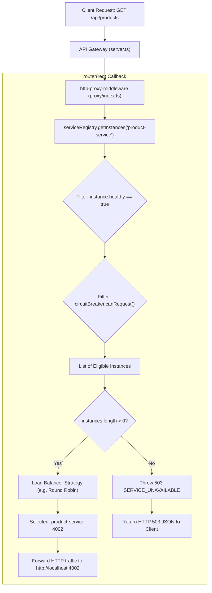

# Dynamic Self-Service Discovery & Heartbeat Monitoring

A complete guide to understanding **why** dynamic service discovery exists, **how** microservices self-register upon booting up, **how** the API Gateway stores services in memory using a `Map`, **how** microservices gracefully unregister on shutdown, and **how** the Gateway instantly cuts off traffic from dead or unregistered nodes.

---

## 1. Why Do We Need This? (The Real-World Problem)

### The Old Way: Static Configuration
In traditional setups, the API Gateway knows about downstream microservices only through hardcoded IP addresses or ports in a `.env` file:

```env
PRODUCT_SERVICE_INSTANCES=http://localhost:4001,http://localhost:4002,http://localhost:4003
```

This static approach breaks down in modern distributed architectures:

1. **Autoscaling Nightmare:**
   Imagine Black Friday traffic hits your bookstore. An autoscaler dynamically launches 10 extra instances of `product-service` on ports `4004` to `4013`. The API Gateway has no idea these 10 new instances exist because they are not in `.env`. The gateway keeps hammering the original 3 instances until they crash under load.

2. **Zero-Downtime Rolling Updates:**
   When deploying a new version of `order-service`, modern infrastructure spins up new containers first, waits for them to become healthy, and then terminates the old ones. With static configuration, you would have to manually edit configuration files and restart the gateway for every deployment.

3. **Silent Traffic Blackholes:**
   If instance `4002` crashes or suffers an Out-Of-Memory (OOM) kill, a static gateway continues forwarding 33% of all customer requests to `4002`, causing immediate `502 Bad Gateway` or `ECONNREFUSED` errors for users.

---

### The New Way: Dynamic Self-Service Discovery
Instead of the gateway relying on static files, the microservices **manage their own presence**:

```text
┌─────────────────┐       1. POST /registry/register        ┌─────────────────────────┐
│                 │────────────────────────────────────────>│       API GATEWAY       │
│                 │                                         │   (Service Registry)    │
│ Product Service │       2. POST /registry/heartbeat       │                         │
│   (Port 4005)   │   (every 10s: "Still healthy!")         │  product-service:       │
│                 │────────────────────────────────────────>│   ├── :4001 (OK)        │
│                 │                                         │   ├── :4002 (OK)        │
│                 │       3. POST /registry/unregister      │   └── :4005 (NEW!)      │
│                 │      (on shutdown: "Signing off")       │                         │
│                 │────────────────────────────────────────>│                         │
└─────────────────┘                                         └─────────────────────────┘
```

1. **Self-Registration:** An instance boots up and introduces itself to the Gateway.
2. **Heartbeats:** The instance repeatedly informs the Gateway that it is alive.
3. **Health Tracking & Eviction:** If heartbeats stop arriving, the Gateway stops sending traffic to it.
4. **Graceful Deregistration:** When shutting down, the instance bids farewell so no requests are lost.

---

## 2. Where Is This Useful? (Industry Use Cases)

| Scenario | How Static Setup Fails | How Dynamic Discovery Solves It |
|---|---|---|
| **Cloud Autoscaling (AWS / GCP / K8s)** | Gateway only knows fixed addresses; newly spawned containers are invisible. | Containers self-register upon container boot; traffic distributes across all nodes immediately. |
| **Microservice Crash / Hang** | Gateway sends requests to dead process; users see 502/ECONNREFUSED errors. | Heartbeats time out after 30s; gateway automatically marks the instance unhealthy and stops routing to it. |
| **Blue/Green Deployments** | Requires restarting the gateway to update routing tables. | New version instances register as they boot; old instances unregister as they drain traffic. |
| **Local Multi-Instance Testing** | You must edit `.env` every time you want to test 5, 10, or 20 instances. | You can spin up any instance on any port (`PORT=9099 npm start`), and it immediately joins the load balancer pool. |

---

## 3. How a Microservice Registers Itself When It Boots Up

The bootup and self-registration lifecycle runs automatically whenever a microservice starts.

### The Startup Sequence (Code Walkthrough)

#### Step 1: The Server Starts Listening
**File:** `product-service/src/server.ts` (also in `user-service` and `order-service`)

When Node.js launches the Express server, `app.listen()` fires its callback once the HTTP server is bound to its port:

```typescript
const server = app.listen(PORT, async () => {
  console.log(`Product Service running on port ${PORT}`);
  
  // Immediately register with Gateway upon successful port bind
  if (process.env.NODE_ENV !== 'test') {
    registerWithGateway({
      serviceName: 'product-service',
      port: PORT,
      instanceId: process.env.SERVICE_INSTANCE_ID // Optional custom ID
    });
  }
});
```

#### Step 2: `registerWithGateway()` Executes
**File:** `product-service/src/registry/registerService.ts`

The registration client performs three actions:
1. **Determines Metadata:** Constructs the service URL and assigns a deterministic instance identifier:
   - `gatewayUrl`: Reads `process.env.GATEWAY_URL || 'http://localhost:8000'`
   - `host`: Defaults to `'localhost'`
   - `port`: The active port (e.g., `4001`)
   - `instanceId`: `${serviceName}-${host}-${port}` (e.g., `'product-service-localhost-4001'`)
   - `url`: `http://${host}:${port}` (e.g., `'http://localhost:4001'`)

2. **Sends Registration HTTP POST:**
   Dispatches an HTTP `POST` request to the API Gateway's registration endpoint:
   ```http
   POST http://localhost:8000/registry/register
   Content-Type: application/json

   {
     "serviceName": "product-service",
     "host": "localhost",
     "port": 4001,
     "id": "product-service-localhost-4001",
     "url": "http://localhost:4001"
   }
   ```

3. **Starts Background Heartbeat Timer:**
   Immediately initializes a non-blocking `setInterval` running every 10 seconds:
   ```typescript
   const timer = setInterval(async () => {
     try {
       const res = await fetch(`${gatewayUrl}/registry/heartbeat`, {
         method: 'POST',
         headers: { 'Content-Type': 'application/json' },
         body: JSON.stringify({ serviceName: options.serviceName, instanceId })
       });
       
       // If Gateway restarted and lost in-memory state, re-register immediately!
       if (res.status === 404) {
         console.log(`[Service Discovery] Gateway requested re-registration for ${instanceId}`);
         await register();
       }
     } catch {
       // Gateway temporarily unreachable; retry on next tick
     }
   }, 10000);
   ```

---

## 4. How the API Gateway Stores Services in Memory (`Map`)

The API Gateway manages registered services through a singleton registry backed by an in-memory `Map`.

### The Core Data Structure
**File:** `api-gateway/src/loadbalance/ServiceRegistry.ts`

Inside the `ServiceRegistry` class:
```typescript
export class ServiceRegistry {
  // Key: serviceName (string) -> Value: Array of ServiceInstance objects
  private services = new Map<string, ServiceInstance[]>();
  ...
}
```

Every service instance is stored as a structured `ServiceInstance` object:
```typescript
export interface ServiceInstance {
  id: string;               // e.g., 'product-service-localhost-4001'
  host: string;             // e.g., 'localhost'
  port: number;             // e.g., 4001
  url: string;              // e.g., 'http://localhost:4001'
  weight: number;           // default: 1 (used by Weighted Round Robin)
  activeConnections: number;// tracked for Least Connections strategy
  healthy: boolean;         // true = healthy, false = do not route traffic
  lastHeartbeat?: number;   // Epoch timestamp in ms of last received heartbeat
  registeredAt?: number;    // Epoch timestamp in ms when instance first registered
}
```

### Visual Representation of Gateway RAM
```text
Map (ServiceRegistry.services)
 ├── "product-service" ──▶ [
 │     {
 │       id: "product-service-localhost-4001",
 │       url: "http://localhost:4001",
 │       healthy: true,
 │       weight: 1,
 │       activeConnections: 0,
 │       lastHeartbeat: 1760451000000,
 │       registeredAt:  1760450900000
 │     },
 │     {
 │       id: "product-service-localhost-4002",
 │       url: "http://localhost:4002",
 │       healthy: true,
 │       weight: 1,
 │       activeConnections: 1,
 │       lastHeartbeat: 1760451005000,
 │       registeredAt:  1760450905000
 │     }
 │   ]
 ├── "order-service" ──▶ [
 │     { id: "order-service-localhost-3003", url: "http://localhost:3003", healthy: true, ... }
 │   ]
 └── "user-service" ──▶ [
       { id: "user-service-localhost-3001",  url: "http://localhost:3001", healthy: true, ... }
     ]
```

### What Happens When `POST /registry/register` Arrives
**File:** `api-gateway/src/registry/registryRoutes.ts` $\to$ `ServiceRegistry.ts`

```typescript
registerInstance(options: RegisterInstanceOptions): ServiceInstance {
  const { serviceName, port } = options;
  const host = options.host || 'localhost';
  const weight = options.weight ?? 1;
  const url = options.url || `http://${host}:${port}`;
  const id = options.id || `${serviceName}-${host}-${port}`;

  // 1. Ensure an array exists for this serviceName in the Map
  if (!this.services.has(serviceName)) {
    this.services.set(serviceName, []);
  }

  const instances = this.services.get(serviceName)!;
  const existingIndex = instances.findIndex(i => i.id === id || i.url === url);
  const now = Date.now();

  // 2. If instance already exists (re-registration on reboot / reconnect):
  if (existingIndex >= 0) {
    const existing = instances[existingIndex]!;
    existing.healthy = true;             // Mark alive
    existing.weight = weight;
    existing.lastHeartbeat = now;        // Update heartbeat timestamp
    console.info(`[ServiceRegistry] Instance re-registered / heartbeat renewed: ${id} (${url})`);
    return existing;
  }

  // 3. Otherwise, create a brand-new ServiceInstance and append to array
  const newInstance: ServiceInstance = {
    id,
    host,
    port,
    url,
    weight,
    activeConnections: 0,
    healthy: true,
    lastHeartbeat: now,
    registeredAt: now,
  };

  instances.push(newInstance);
  console.info(`[ServiceRegistry] Instance registered: ${id} (${url}) for ${serviceName}. Total: ${instances.length}`);
  return newInstance;
}
```

---

## 5. How a Microservice Unregisters (Graceful Shutdown)

When a microservice process terminates normally (such as during a rolling deployment, auto-scaling scale-down, or an operator pressing `Ctrl+C`), it cleanly deregisters itself from the Gateway.

### Step 1: Trapping OS Termination Signals
**File:** `product-service/src/registry/registerService.ts`

The service intercepts standard POSIX termination signals:
```typescript
process.once('SIGINT', async () => {
  await unregister();
  process.exit(0);
});

process.once('SIGTERM', async () => {
  await unregister();
  process.exit(0);
});
```

### Step 2: Sending the Deregistration Request
Before calling `process.exit(0)`, the `unregister()` function executes:
1. **Stops Heartbeat Timer:** `clearInterval(timer)` prevents any future heartbeats from firing.
2. **Calls Gateway Deregistration Endpoint:**
   ```http
   POST http://localhost:8000/registry/unregister
   Content-Type: application/json

   {
     "serviceName": "product-service",
     "instanceId": "product-service-localhost-4001"
   }
   ```

### Step 3: Gateway Removes the Instance from the Map
**File:** `api-gateway/src/loadbalance/ServiceRegistry.ts`

When `unregisterInstance` runs on the Gateway:
```typescript
unregisterInstance(serviceName: string, instanceId: string): boolean {
  const instances = this.services.get(serviceName);
  if (!instances) return false;

  const index = instances.findIndex(i => i.id === instanceId);
  if (index >= 0) {
    // Splicing removes the element from the in-memory array
    instances.splice(index, 1);
    console.info(`[ServiceRegistry] Instance unregistered: ${instanceId} from ${serviceName}. Remaining: ${instances.length}`);
    return true;
  }
  return false;
}
```

Once `splice` executes, that instance **no longer exists** in the Gateway's array.

---

## 6. How the Gateway Stops Sending Traffic to Dead or Unregistered Nodes

To understand how traffic is cut off, we look at the request routing pipeline in the Gateway.

### The Request Routing Pipeline


### The Code Behind the Cut-Off
**File:** `api-gateway/src/loadbalance/ServiceRegistry.ts` & `api-gateway/src/proxy/index.ts`

When a client sends `GET /api/products`, the proxy router executes:

```typescript
// proxy/index.ts
router: (req) => {
  // 1. Fetch only registered, healthy instances
  const instances = serviceRegistry.getInstances(serviceName);
  
  // 2. If no healthy instances exist, fail fast with 503
  if (instances.length === 0) {
    const err: any = new Error(`No healthy instances available for ${serviceName}`);
    err.status = 503;
    err.code = 'SERVICE_UNAVAILABLE';
    throw err;
  }

  // 3. Load Balancer selects from ONLY the healthy list
  const selectedInstance = lbStrategy.selectInstance(serviceName, instances, context);
  return selectedInstance.url;
}
```

And inside `serviceRegistry.getInstances()`:
```typescript
// ServiceRegistry.ts
getInstances(serviceName: string): ServiceInstance[] {
  // Filter 1: Strip out any instance where healthy === false
  let instances = (this.services.get(serviceName) || []).filter(i => i.healthy);

  // Filter 2: Strip out any instance whose Circuit Breaker is OPEN
  if (circuitBreakerRegistry.isEnabled()) {
    instances = instances.filter(i => circuitBreakerRegistry.get(i.id).canRequest());
  }

  return instances;
}


```

### How the Gateway Stops Sending Traffic to Dead or Unregistered Nodes**

Think of the API Gateway like a **restaurant manager** with a list of active waiters (microservices). 

The Golden Rule: **The Gateway never sends a customer to a waiter without checking the "active & healthy" list first.**

Here is how it stops traffic to dead or unregistered nodes in 3 simple steps:

---

### Step 1: How a Node Gets Marked as "Dead" or "Removed"

There are two ways a node stops serving:

#### Case A: The node shut down cleanly (Graceful Exit)
The node tells the gateway: *"I'm shutting down!"*
The Gateway immediately removes it from the in-memory array using `splice`:
```typescript
// ServiceRegistry.ts
const index = instances.findIndex(i => i.id === instanceId);
instances.splice(index, 1); // ❌ It is completely deleted from the list!
```

#### Case B: The node crashed suddenly (e.g., power cut or killed)
It couldn't say goodbye, so its 10-second heartbeat stops coming. 
Every 15 seconds, the Gateway checks: *"Who hasn't pinged me in 30 seconds?"*
```typescript
// ServiceRegistry.ts
if (now - instance.lastHeartbeat > 30000) {
  instance.healthy = false; // ❌ Marked UNHEALTHY
}
```

---

### Step 2: The Bouncer (Filtering Before Every Request)

Whenever a customer makes a request (like `GET /api/products`), the Gateway runs a **filter check** before routing:

```typescript
// ServiceRegistry.ts
getInstances(serviceName: string): ServiceInstance[] {
  // ONLY keep instances where healthy === true!
  return this.services.get(serviceName).filter(i => i.healthy);
}
```

#### In Plain English:
* If instance `:4002` was **unregistered**, it was already deleted from the array.
* If instance `:4002` **crashed**, its `healthy` flag is `false`.
* The `.filter(i => i.healthy)` function throws `:4002` out!

The result? The list returned only contains live, healthy nodes:
```text
All Nodes:     [:4001 (healthy), :4002 (unhealthy), :4003 (healthy)]
Filtered List: [:4001, :4003]
```

---

### Step 3: The Load Balancer Can Only Pick Survivors

Now the Gateway hands that filtered list to the Load Balancer (Round Robin, Least Connections, etc.):

```typescript
// proxy/index.ts
const healthyInstances = serviceRegistry.getInstances('product-service');

// The Load Balancer picks from healthyInstances ONLY:
const selected = lbStrategy.selectInstance('product-service', healthyInstances);

return selected.url; // Forwards request to the winner
```

#### Why it never sends traffic to the dead node:
The Load Balancer **never even knows `:4002` existed**. It only sees `[:4001, :4003]`. It physically cannot pick `:4002` because `:4002` is not on the menu.

---

### Step 4: What if ALL instances are dead?

If every single instance crashes or unregisters, the filtered list is completely empty `[]`.

Instead of hanging or trying to connect to a dead server, the Gateway catches it immediately:

```typescript
// proxy/index.ts
if (healthyInstances.length === 0) {
  res.status(503).json({
    error: "No healthy instances available for product-service"
  });
}
```

The customer gets a fast, clean **HTTP 503 (Service Unavailable)** error instead of an ugly connection timeout or browser freeze.

### Comparison: What Happens Across Failure States

| State | What Happened | Map / Registry State | How Traffic is Cut Off |
|---|---|---|---|
| **Gracefully Unregistered** | Process received `SIGTERM` / `SIGINT` and called `POST /registry/unregister`. | `instances.splice(index, 1)` executed. Instance is **completely absent** from the array. | `getInstances()` never sees the instance. Load balancer cannot select it. Zero dropped requests. |
| **Abrupt Crash / Network Partition** | Process crashed (`SIGKILL`, power loss, network partition). No unregister call sent. | Instance remains in the array, but `lastHeartbeat` stops updating. | Within 30 seconds, Gateway's `checkHeartbeats()` detects `now - lastHeartbeat > 30000` and sets `instance.healthy = false`. Filter `i.healthy` excludes it immediately. |
| **Application Errors (500s / DB Down)** | Process is running and pings heartbeats, but fails business requests (e.g. database down). | `healthy: true` (heartbeat passes), but Circuit Breaker tracks error rate. | After 3 consecutive 5xx errors, Circuit Breaker trips to `OPEN`. `circuitBreaker.canRequest()` returns `false`. `getInstances()` filters it out. |
| **All Instances Down** | All instances of a service are dead or unregistered. | `getInstances(serviceName)` returns `[]`. | Gateway immediately intercepts `instances.length === 0` and responds with **HTTP 503 Service Unavailable** JSON without attempting dead network sockets. |

---

## 7. The Heartbeat & Health Check Subsystems

The Gateway uses a **dual-layer** detection system:

### 1. Passive Inbound Heartbeats (Push)
* Every instance pings `POST /registry/heartbeat` every 10 seconds.
* Gateway updates `instance.lastHeartbeat = Date.now()`.
* If a previously marked unhealthy instance sends a heartbeat, Gateway logs:
  `[ServiceRegistry] Instance product-service-4001 recovered via heartbeat.` and restores `healthy = true`.

### 2. Active Outbound Health Checks (Pull)
* Gateway runs `startHealthChecks(intervalMs = 15000)` every 15 seconds.
* Performs `checkHeartbeats(timeoutMs = 30000)`:
  If `now - instance.lastHeartbeat > 30000ms`, marks `instance.healthy = false`.
* Performs HTTP `fetch(`${instance.url}/health`)`:
  If status is not `200`, marks `instance.healthy = false`.

---

## 8. Summary Architecture Map

```text
┌────────────────────────────────────────────────────────────────────────┐
│                              API GATEWAY                               │
│                                                                        │
│   ┌────────────────────────────────────────────────────────────────┐   │
│   │                    ServiceRegistry (Singleton)                 │   │
│   │                                                                │   │
│   │   services = new Map<string, ServiceInstance[]>()              │   │
│   │     "product-service" => [                                     │   │
│   │       { id: "product-4001", healthy: true,  lastHeartbeat },   │   │
│   │       { id: "product-4002", healthy: false, lastHeartbeat },   │   │
│   │     ]                                                          │   │
│   └───────────────────────▲────────────────────────▲───────────────┘   │
│                           │                        │                   │
│         HTTP Registration │     Routing & Filtering│                   │
│         & Heartbeat REST  │     getInstances()     │                   │
│                           │                        │                   │
│   ┌───────────────────────┴──────┐   ┌─────────────┴───────────────┐   │
│   │    registryRouter (REST)     │   │     createProxyMiddleware   │   │
│   │   - POST /registry/register  │   │     - router: (req) => {    │   │
│   │   - POST /registry/heartbeat │   │         getInstances(...)   │   │
│   │   - POST /registry/unregister│   │         selectInstance(...) │   │
│   └──────────────▲───────────────┘   │       }                     │   │
│                  │                   └───────────────▲─────────────┘   │
└──────────────────┼───────────────────────────────────┼─────────────────┘
                   │                                   │
      Heartbeat &  │                      User Traffic │
      Registration │                      HTTP Request │
                   │                                   │
┌──────────────────┴───────────────────────────────────┴─────────────────┐
│                        MICROSERVICE INSTANCE                           │
│                                                                        │
│   ┌──────────────────────────────┐   ┌─────────────────────────────┐   │
│   │     registerService.ts       │   │         server.ts           │   │
│   │   - registerWithGateway()    │   │   - app.listen(PORT)        │   │
│   │   - 10s heartbeat timer      │   │   - GET /health             │   │
│   │   - SIGTERM/SIGINT hooks     │   │   - domain business routes  │   │
│   └──────────────────────────────┘   └─────────────────────────────┘   │
└────────────────────────────────────────────────────────────────────────┘


```
### 4. Edge Cases & Resilience Features

### 1. What if the API Gateway Restarts?
If the API Gateway crashes or restarts, its in-memory `Map` is wiped clean. 
- The next time microservices send their 10-second heartbeat, the Gateway returns `404 Not Found (Instance not found in registry)`.
- The microservice detects the `404` and immediately calls `register()` again.
- **Result:** Within 10 seconds of a Gateway restart, all microservices re-populate the registry automatically with zero human intervention.

### 2. Graceful Shutdown (Deregistration on Exit)
If an operator stops a service using `Ctrl + C` or Kubernetes sends `SIGTERM`:
```typescript
process.once('SIGTERM', async () => {
  await unregister(); // Sends POST /registry/unregister
  process.exit(0);
});
```
The Gateway removes the instance from the list **before** the process terminates. Not a single in-flight request is dropped.

### 3. Circuit Breaker Synergy
- **Heartbeats** detect if a process is **alive at the network layer**.
- **Circuit Breaker** detects if a process is **failing at the application layer** (e.g., throwing 500 database errors even while its process is alive).
- Both systems work together inside `getInstances()` to ensure only 100% operational instances serve users.

---

```
