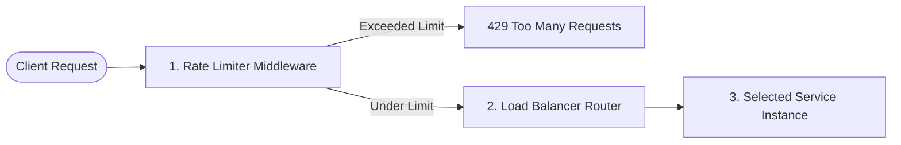
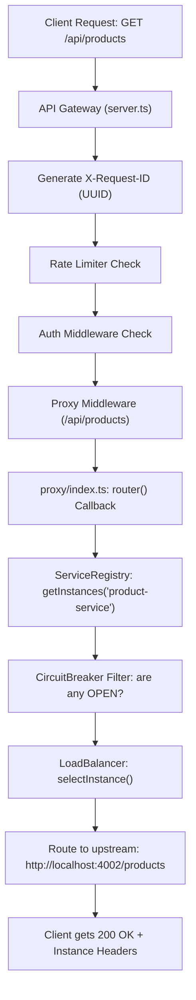

### 1. How are we creating 20 instances of a service?

We do **not** duplicate any code files. Instead, we use Node's `child_process.spawn()` in [`test/process-manager.js`](file:///home/bumblebee/apigateway/test/process-manager.js).

When you request 20 instances of `product-service`:
1. **Spawns Separate OS Processes:** It executes `npm start` 20 times in a loop against the same `product-service` directory.
2. **Injects Unique Environment Variables:** Each process gets injected with a unique `PORT` and `SERVICE_INSTANCE_ID`:
   - Process 1: `PORT=4001`, `SERVICE_INSTANCE_ID=product-4001`
   - Process 2: `PORT=4002`, `SERVICE_INSTANCE_ID=product-4002`
   - ...
   - Process 20: `PORT=4020`, `SERVICE_INSTANCE_ID=product-4020`
3. **Informs the Gateway:** The test launcher then starts the Gateway with:
   ```env
   PRODUCT_SERVICE_INSTANCES=http://localhost:4001,http://localhost:4002,...,http://localhost:4020
   ```
4. **Clean Shutdown:** When you stop the test, the script sends `SIGTERM` signals to terminate all 20 child process IDs (`PIDs`).

---

### 2. How can we send 100 requests so fast?

In Node.js, network I/O is asynchronous and non-blocking:

* **In Bash scripts** (`test/test-ratelimit.sh`): A simple `for` loop fires `curl` commands in rapid succession. Because curl runs locally against `localhost:8000`, each round-trip takes only 1–3 milliseconds.
* **In Node.js scripts** (`test/send-requests.js` or `test/concurrent-test.js`): It uses Node's native `http.request`. In concurrent mode (`Promise.all`), Node opens parallel TCP sockets and dispatches all 100 requests within a few milliseconds without waiting for one request to finish before firing the next.

---

### 3. Does a request go through Rate Limiter first, then Load Balancer?

**Yes, absolutely!** 

In Express, middleware executes sequentially in the order registered in [`api-gateway/src/server.ts`](file:///home/bumblebee/apigateway/api-gateway/src/server.ts):



1. **Step 1 — Rate Limiter (`app.use('/api', rateLimiter(...))`):**
   - Checks client IP and current token/bucket/window state.
   - If limit is reached, it immediately returns `429 Too Many Requests`. The request **never** reaches the load balancer or the backend services (protecting your backend instances from overload).
2. **Step 2 — Load Balancer (`setupProxies(app)`):**
   - Only executed if the request passed the rate limiter.
   - Selects a healthy instance based on the strategy (`RANDOM`, `ROUND_ROBIN`, etc.) and proxies the request to that backend port.


   Here are the answers to all four of your questions:

---

### 1. "So normally now only one instance is running, right? All requests go to the same instance?"

**Yes, exactly!**
When you run the system normally (via `./start.sh` or `npm run start`), only:
- 1 User Service (`:3001`)
- 1 Product Service (`:3002`)
- 1 Order Service (`:3003`)
- 1 API Gateway (`:8000`)

are running. 

Because [`ServiceRegistry.ts`](file:///home/bumblebee/apigateway/api-gateway/src/loadbalance/ServiceRegistry.ts) only finds that single instance configured, your Load Balancer simply selects that 1 instance for every request. There is no background overhead, and everything behaves as a standard single-instance setup.

---

### 2. "How would I manually turn on 20 instances of any service?"

If you wanted to do this manually without using the test harness script, you would do two things:

#### Step A: Launch the instances on different ports
Open separate terminals (or use a process manager like PM2 / bash loop) and supply different `PORT` values:

```bash
# Terminal / Script:
cd product-service
PORT=4001 npm start
PORT=4002 npm start
PORT=4003 npm start
# ... all the way to 4020
```

#### Step B: Tell the API Gateway about the instances in `.env`
In your root `.env` file, specify the comma-separated list of URLs:

```env
PRODUCT_SERVICE_INSTANCES=http://localhost:4001,http://localhost:4002,http://localhost:4003,http://localhost:4004,...,http://localhost:4020
LOAD_BALANCER_STRATEGY=ROUND_ROBIN
```

When you start the API Gateway (`cd api-gateway && npm start`), it reads `PRODUCT_SERVICE_INSTANCES` and distributes incoming `/api/products` requests across all 20 ports.

---

### 3. "In deployment, do I manually run 20 instances or do modern cloud tools manage that?"

In real-world production environments, **modern cloud platforms automate this for you**. You almost never start 20 instances manually:

#### Approach A: Cloud Orchestrators (Docker / Kubernetes / ECS)
- **Kubernetes (K8s):** You write a config saying `replicas: 5` (or set up a Horizontal Pod Autoscaler). If traffic surges, Kubernetes automatically spawns new containers (e.g. from 3 up to 20 instances) and scales down when traffic drops.
- **Service Discovery / Internal DNS:** Cloud systems like Kubernetes provide an internal DNS name (e.g., `http://product-service:3000`). When the Gateway talks to that DNS name, the cloud's internal network routes traffic among all 20 running containers.

#### Approach B: Reverse Proxies & Cloud Load Balancers
- Cloud platforms (like AWS ALB, GCP Cloud Load Balancing, NGINX, Cloudflare) can also sit in front of the instances to balance traffic across multiple machines/regions automatically.

#### Why Having This in the API Gateway Still Matters:
- **Application-Level Routing:** Cloud load balancers usually only do simple round-robin. In-gateway load balancing allows advanced strategies like **Consistent Hashing** (routing the same user to the same cache-warmed node) or **Least Connections**.
- **Service Mesh & Microservices:** It allows microservices inside your internal private network to load-balance between each other without needing an expensive cloud load balancer for every individual internal service.


Viewed ecosystem.config.cjs:1-40
Viewed start.sh:1-44
Viewed package.json:1-33

### 1. Why PM2? What does it do apart from just starting services?

While a simple bash command or `npm start` can launch a Node process, **PM2** is a production-grade **Process Manager**. In a microservices architecture with multiple separate services, PM2 provides critical capabilities beyond just executing a script:

1. **Background Daemonizing (No Cluttered Terminals)**:
   - Without PM2, launching 5 services would require keeping 5 separate terminal tabs or windows open. Closing a terminal would kill that service.
   - PM2 detaches the processes into background system daemons so they keep running independently.

2. **Automatic Crash Recovery & Self-Healing**:
   - In standard Node.js, an unhandled exception or crash terminates the process permanently.
   - PM2 automatically monitors PID health and **restarts a crashed service within milliseconds**, preventing downtime.

3. **Centralized Log Streaming & Aggregation**:
   - Rather than logs getting lost or printed into random terminal screens, PM2 pipes all `stdout` and `stderr` to structured log files (`~/.pm2/logs/`).
   - You can inspect real-time logs across all services or for a single service:
     ```bash
     npx pm2 logs              # Stream all service logs simultaneously
     npx pm2 logs api-gateway  # Stream only gateway logs
     ```

4. **Resource Monitoring & Health Metrics**:
   - PM2 tracks real-time CPU consumption, RAM usage, process uptime, and restart frequency:
     ```bash
     npx pm2 list    # Table view of all microservices
     npx pm2 monit   # Interactive terminal dashboard for memory/CPU
     ```

5. **Single-Command Lifecycle Management**:
   - Instead of tracking down process PIDs to kill or restart (`kill -9 $(lsof -t -i:8000)`), you manage everything via declarative config in [`ecosystem.config.cjs`](file:///home/bumblebee/apigateway/ecosystem.config.cjs):
     ```bash
     npx pm2 restart api-gateway   # Quick restart after code change
     ./stop.sh                     # Stops and clears all services cleanly
     ```

---

### 2. How to Start Each Service Manually (Without PM2)

If you are actively debugging, want to see `console.log` directly in individual terminals, or simply don't want PM2 running:

> [!IMPORTANT]
> If PM2 is currently running, stop it first to free up the ports:
> ```bash
> ./stop.sh
> # or: npx pm2 delete all
> ```

Make sure MongoDB is running locally (`mongod`), then open **5 separate terminal tabs** in `/home/bumblebee/apigateway`:

#### **Terminal 1: User Service** (Port 3001)
```bash
cd /home/bumblebee/apigateway/user-service
npm start
```

#### **Terminal 2: Product Service** (Port 3002)
```bash
cd /home/bumblebee/apigateway/product-service
npm start
```

#### **Terminal 3: Order Service** (Port 3003)
```bash
cd /home/bumblebee/apigateway/order-service
npm start
```

#### **Terminal 4: API Gateway** (Port 8000)
```bash
cd /home/bumblebee/apigateway/api-gateway
npm start
```

#### **Terminal 5: Frontend UI** (Port 5173)
```bash
cd /home/bumblebee/apigateway/frontend
npm run dev
```

---


Here is a step-by-step **dry run** walking through the entire lifecycle—from how a service registers itself to how an incoming request gets load-balanced and routed.

---

### Step 1: Microservice Boots & Self-Registers

Let's say you start a new instance of **Product Service** on port `4002`.

1. **Service Starts:** [`product-service/src/server.ts`](file:///home/bumblebee/apigateway/product-service/src/server.ts) starts listening on port `4002`.
2. **Auto-Registration Trigger:** In [`registerService.ts`](file:///home/bumblebee/apigateway/product-service/src/registry/registerService.ts#L23), it immediately fires an HTTP call to the Gateway:
   ```http
   POST http://localhost:8000/registry/register
   {
     "serviceName": "product-service",
     "port": 4002,
     "host": "localhost",
     "id": "product-dynamic-4002",
     "url": "http://localhost:4002"
   }
   ```
3. **Gateway Stores It:** The Gateway's [`ServiceRegistry`](file:///home/bumblebee/apigateway/api-gateway/src/loadbalance/ServiceRegistry.ts#L49-L88) receives this and adds it to its internal memory map:

```
ServiceRegistry Map:
"product-service" ──▶ [
  { id: "product-dynamic-4001", url: "http://localhost:4001", healthy: true },
  { id: "product-dynamic-4002", url: "http://localhost:4002", healthy: true }  <-- Added!
]
```

4. **Heartbeat Loop:** Every 10 seconds, `product-service` pings `POST /registry/heartbeat`. If it misses heartbeats for 30 seconds, the Gateway marks `healthy: false`.

---

### Step 2: Client Sends a Request to API Gateway

A user opens their browser or app and requests:
```http
GET http://localhost:8000/api/products
```

Here is what happens inside the Gateway pipeline:



---

### Step 3: Inside `proxy/index.ts` — The Load Balancer in Action

When Express hits the proxy route in [`api-gateway/src/proxy/index.ts`](file:///home/bumblebee/apigateway/api-gateway/src/proxy/index.ts#L15-L41):

#### 1. Querying Healthy Instances
```ts
const instances = serviceRegistry.getInstances('product-service');
```
* The registry checks health status (`healthy === true`) **AND** checks the Circuit Breaker (`circuitBreaker.canRequest() === true`).
* Returns the usable pool:
  ```ts
  [
    { id: "product-dynamic-4001", url: "http://localhost:4001" },
    { id: "product-dynamic-4002", url: "http://localhost:4002" }
  ]
  ```

#### 2. The Load Balancer Decision
The Gateway calls the selected algorithm (e.g. `ROUND_ROBIN` in [`RoundRobinStrategy.ts`](file:///home/bumblebee/apigateway/api-gateway/src/loadbalance/RoundRobinStrategy.ts)):

```ts
const selectedInstance = lbStrategy.selectInstance('product-service', instances, context);
```

**Under the hood (Round Robin dry run):**
* The strategy keeps an internal counter per service:
  ```ts
  counter = this.counters.get('product-service') // currently 0
  index = counter % instances.length             // 0 % 2 = 0 -> chooses 4001
  this.counters.set('product-service', counter + 1)
  ```
* **Request 1:** `index = 0` $\rightarrow$ routes to `http://localhost:4001`
* **Request 2:** `index = 1` $\rightarrow$ routes to `http://localhost:4002`
* **Request 3:** `index = 2 % 2 = 0` $\rightarrow$ wraps back to `http://localhost:4001`

#### 3. Rewriting & Forwarding
The router function returns:
```ts
return selectedInstance.url; // "http://localhost:4002"
```
`http-proxy-middleware` forwards the request directly to:
```
http://localhost:4002/products
```

---

### Step 4: Upstream Response & Tracking

When `product-service` on port `4002` finishes processing:

1. **Proxy attaches observability headers** in [`proxyRes`](file:///home/bumblebee/apigateway/api-gateway/src/proxy/index.ts#L51-L68):
   * `x-upstream-instance: product-dynamic-4002`
   * `x-upstream-url: http://localhost:4002`
   * `x-lb-strategy: ROUND_ROBIN`
2. **Circuit Breaker updates:**
   * If status is `200`, records `circuitBreaker.onSuccess()`.
   * If status is `500+`, records `circuitBreaker.onFailure()`.
3. **Least Connections counter:**
   * If using `LEAST_CONNECTIONS`, decrements `activeConnections` on port `4002`.
4. **Client receives response:**
   ```json
   {
     "products": [ ... ]
   }
   ```

---

### What happens if an instance crashes? (The Safety Net)

If `4002` crashes or starts failing:
1. **Circuit Breaker trips to `OPEN`** after 3 failures.
2. Next time `serviceRegistry.getInstances('product-service')` runs:
   * It sees `4002` is `OPEN` and **excludes it** from the array.
3. The Load Balancer now only receives `[ 4001 ]`.
4. Traffic is **100% routed to 4001**, preventing any clients from seeing errors.


### Summary Comparison

| Task | Manual (Multi-terminal) | With PM2 |
| :--- | :--- | :--- |
| **Startup** | Open 5 terminals, `cd` into each, run commands | `./start.sh` (or `npx pm2 start ecosystem.config.cjs`) |
| **On Crash** | Process dies; requires manual restart in terminal | Automatically restarts immediately |
| **Logging** | Scattered across 5 active terminal windows | Streamed together via `npx pm2 logs` |
| **Shutdown** | Press `Ctrl + C` in each of the 5 terminals | `./stop.sh` |


Viewed server.ts:55-70

You are not missing anything conceptually — your understanding of how the **60-second rate limiter window** should behave is **100% correct**. 

The reason you got another 100 successful requests in the second run comes down to **process lifecycles** and **where the rate limiter stores its memory**.

---


### The Cause: The Gateway Restarts Between Script Runs

Look at the end of [`test/test-algo.sh`](file:///home/bumblebee/apigateway/test/test-algo.sh#L54-L60):

```bash
# 3. Clean up all child processes so they don't consume memory
echo "🧹 Cleaning up test processes..."
npm run test:lb:stop > /dev/null 2>&1
kill $HARNESS_PID 2>/dev/null
```

Every time you execute `./test/test-algo.sh`:
1. It spawns **fresh** microservice processes and a **fresh API Gateway process**.
2. It sends 200 requests.
3. It **kills and terminates** all those processes when the script finishes.

---

### Where the Rate Limiter Stores Its State: RAM (`Map`)

Look inside [`FixedWindowStrategy.ts`](file:///home/bumblebee/apigateway/api-gateway/src/ratelimit/FixedWindowStrategy.ts#L6):

```typescript
export class FixedWindowStrategy implements RateLimiterStrategy {
  private limit: number;
  private windowMs: number;
  // 👇 Counter is stored in Node.js process RAM:
  private counters = new Map<string, { count: number; windowStart: number }>();
```

Because the counter is stored in a JavaScript `new Map()` in process memory:

```text
Run #1:
  1. Boot API Gateway (Process PID A) ───> Map is empty: { count: 0 }
  2. First 100 requests              ───> count reaches 100
  3. Next 100 requests               ───> ❌ 429 Rate Limit Exceeded
  4. Script finishes                 ───> Process PID A is KILLED (RAM wiped)

Run #2:
  1. Boot NEW API Gateway (Process PID B) ───> Brand NEW Map: { count: 0 }
  2. First 100 requests              ───> count reaches 100 again!
  3. Next 100 requests               ───> ❌ 429 Rate Limit Exceeded
  4. Script finishes                 ───> Process PID B is KILLED
```

The second Gateway process has **no memory of the previous Gateway process** because they were two completely separate OS processes!

---


### Key Takeaway for System Design & Interviews

| Storage Type | Behavior on Process Restart / Multi-Instance | Used in |
|---|---|---|
| **In-Memory (`Map`)** (Current) | Resets whenever the process restarts. If you run 2 Gateway instances, each has its own independent 100-request quota. | Local dev, single-instance services, low complexity |
| **Distributed (Redis)** | Survives process restarts. All Gateway instances share the exact same key (`INCR ip:timestamp` with `EXPIRE 60`). | Production distributed systems |

